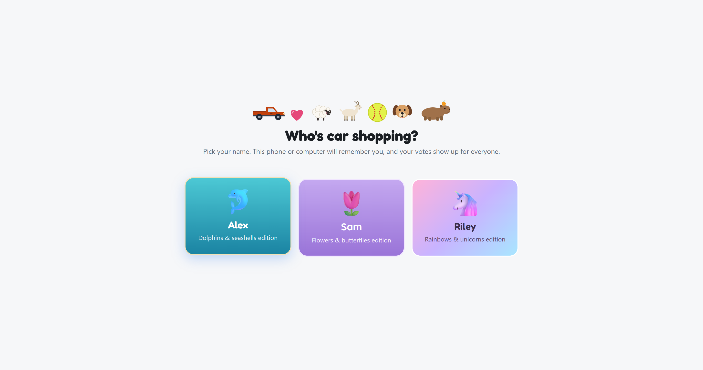
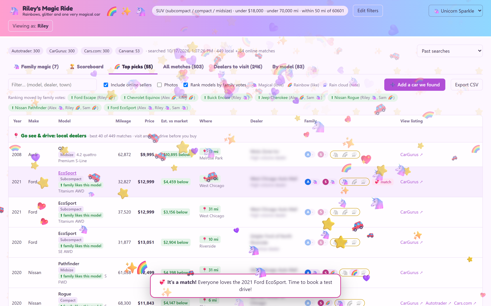
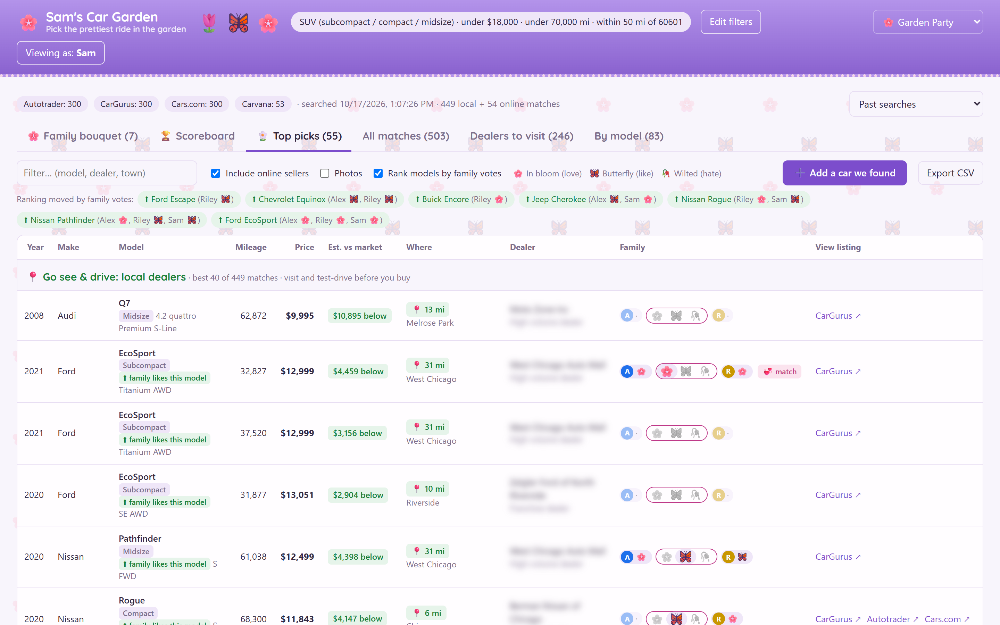
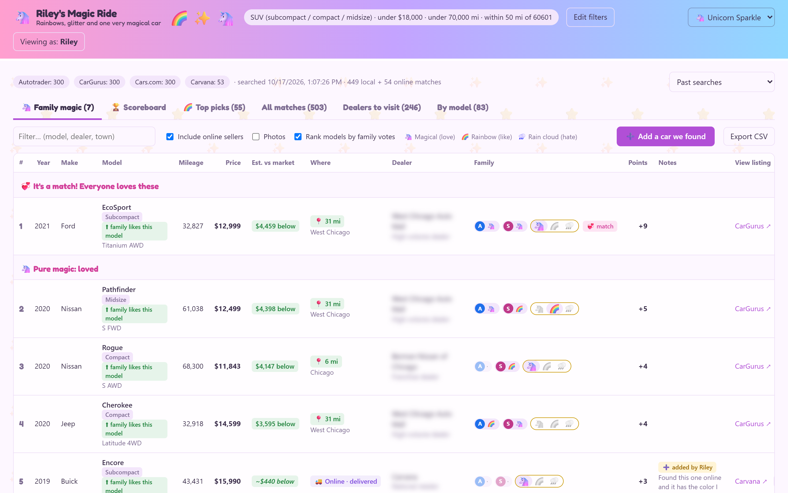
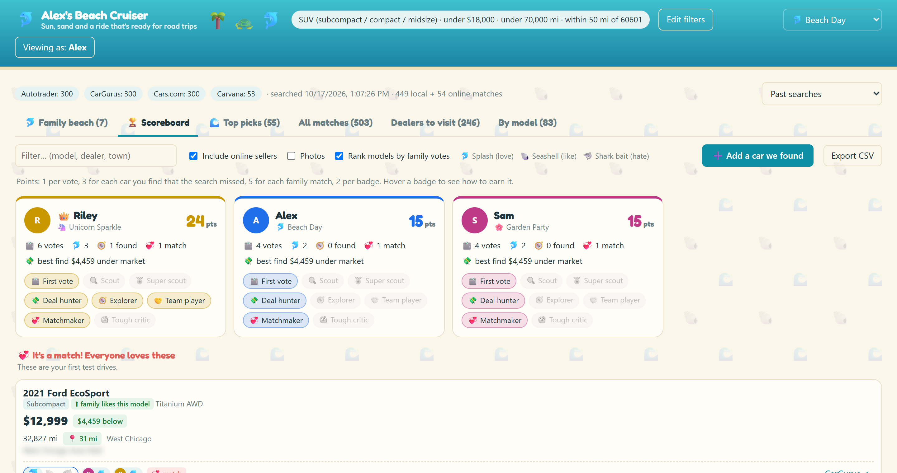
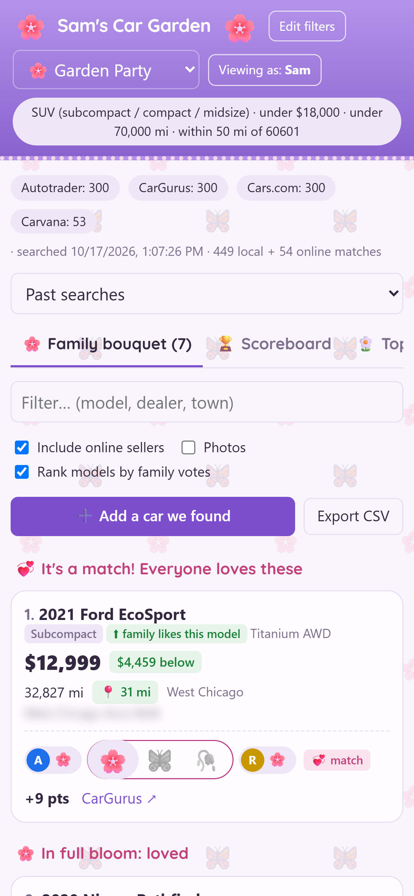

# Family Car Finder 🚗

A little app for shopping for a used car **as a family**. Instead of texting links and screenshots back and forth, everyone opens the
same page on your home Wi-Fi, votes on cars, and the family's favorites (and the local dealers worth a visit) rise to the top.

It's also a way to bring your kids into the decision. Every vote comes with emoji reactions, everyone earns points and badges, and
when the whole family loves the same car, it's a **💞 Family Match**: that's your first test drive.

It runs on one computer in your house. It's not a polished product or a hosted service, just a handy family tool.

## A quick look

*Screenshots from a made-up demo family (Alex, Sam and Riley) searching near Chicago. Dealer names are blurred and listing photos are switched off.*

| | |
|---|---|
|  |  |
| **Who's shopping?** Tap your name; each person has their own look. | **💞 Family Match:** everyone loved the same car. Book that test drive. |
|  |  |
| **Top picks:** local dealers first, price vs. market, everyone's votes. | **Family list:** matches on top, then loved and liked, cheaper first. |
|  |  |
| **🏆 Scoreboard:** points and badges for helping out. | **Works on phones,** with big buttons for quick votes. |

## Why not just use the "save" buttons on car sites?

Car sites and dealers offer good tools for **one shopper**: a heart to save a car, a "My Garage" or favorites list, price-drop alerts,
and a share button that sends a link. A family decision looks different:

- **Everyone's saves end up in different places.** Mom's favorites are in her account on one site, the teenager's are on another site,
  and Dad has a pile of links in a group text.
- **There's no family vote.** You can share a link, but there's nowhere to see that two of you love a car and one of you can't stand it.
- **There's no ranking across sites.** Each site ranks only its own listings. Nothing puts the Cars.com find next to the CarGurus deal
  and the dealer's own listing, and sorts them by what the family thinks and how good the price is.
- **No "which dealers are worth the drive."** Saved cars don't tell you which lots near you have several of your family's favorites,
  so a Saturday of test drives can be planned around them.

Family Car Finder doesn't replace those sites. It searches them, then gives your family **one shared list** to react to together,
ranked by your votes and the price.

## 🔒 Privacy: it stays at home

- **Runs on your own computer.** There's no account, no sign-up, no cloud server, and no tracking or analytics.
- **Your family's info stays on that computer.** Names, votes, notes and searches are saved only in files on the computer running it
  (`config.json` and the `results/` folder). They're never uploaded anywhere, and they're excluded from git so they can't be pushed by accident.
- **No AI.** The app doesn't use AI, chatbots or machine learning, and nothing you type is sent to an AI service. Ranking is plain arithmetic:
  price vs. estimated market value, plus your family's vote points.
- **What does use the internet:**
  - **Searching** contacts CarGurus, Autotrader, Cars.com and Carvana with your ZIP and filters, the same as visiting those sites in a browser.
  - **Car photos** load from those sites.
  - **Pasting a link** into "Add a car we found" opens that page to read the car's details.
  - **Setup** downloads the Python packages it needs and a US ZIP-code table (GeoNames), once.
  - **Fonts are bundled** with the app, so the page doesn't load anything from Google.
- **Home network only.** There are no passwords: anyone on your Wi-Fi with the link can open the page. Don't expose it to the internet
  (no port forwarding).

## What it does

- **Searches the big sites for you:** CarGurus, Autotrader, Cars.com and Carvana, near your ZIP, for the body style, budget and mileage you set.
- **Keeps the list short:** ranks cars by price vs. estimated market value and shows the top picks, so you see a few dozen good options, not thousands.
- **Puts cars you can go see first:** 📍 local dealers you can visit and test-drive are listed ahead of 🚚 online sellers that deliver.
- **Lets everyone vote:** each person taps their name, then reacts to cars with **love / like / hate**. Votes show up for everyone.
- **Learns from votes:** hate one Studebaker Lark and every Lark sinks (Studebaker hasn't built a car since 1966, so no hard feelings); like a model and it moves up a little. The **Family list** ranks everything you've voted on.
- **Shows which dealers are worth the drive:** **Dealers to visit** ranks nearby dealers by good matches and family favorites.
- **Skip a dealer:** if a dealer isn't for you (say, a repair shop that also lists a few cars), tap the ✕ by its name to hide all its
  cars for everyone. The top picks refill from other dealers, votes you already made are kept, and **Hidden dealers** brings it back.
- **Takes cars you found yourself:** **➕ Add a car we found** lets you paste a link and it fills in the details.
- **Works on phones and computers.**

## Make it a family game 🎮

- **Pick a look:** each person chooses a theme during setup, and votes become emoji reactions with confetti-style flurries:
  - 🚗 Classic
  - 🥎 Ballpark (softball, dogs, capybaras)
  - 💖 Farmhouse (hearts, dogs, goats, sheep)
  - 🛻 Truck Yard
  - 🌸 Garden Party (flowers, butterflies)
  - 🦄 Unicorn Sparkle (rainbows, glitter)
  - 🐬 Beach Day (dolphins, seashells)
  - ☕ Cozy Café (lattes, cats)
- **💞 Family Match:** when everyone loves the same car, the page celebrates and the car jumps to the top. Book that test drive first.
- **🏆 Scoreboard:** points for voting, finding cars and making matches, plus badges like 🔍 Scout, 💸 Deal Hunter, 🧭 Explorer,
  🤝 Team Player and 💞 Matchmaker. Whoever's in the lead gets the 👑.

### Ideas for parents and kids

- **Give kids real jobs.** The 💸 **Deal Hunter** badge goes to spotting a car well below market value, and 🧭 **Explorer** to finding one the search missed.
- **Talk about what the numbers mean.** Why might a car be cheap? (High miles? An accident?) Is a local car you can test-drive worth more than one delivered?
- **Make a family rule:** test-drive the 💞 matches first. Everyone's vote counts.
- **Let older kids own a piece:** comparing mileage, checking a car's history, or planning the route to the dealers.

## Setup (about 5 minutes)

✅ **Tested on Windows 11 and macOS (Apple Silicon).** Linux should work the same way with `./setup.sh` and `./start.sh`, but hasn't been tested yet.

You need **Python 3.10 or newer**:
- **Windows:** install from [python.org](https://www.python.org/downloads/) and tick *"Add python.exe to PATH"*.
- **Mac:** the Python that comes with macOS (3.9) is too old. Install from [python.org](https://www.python.org/downloads/macos/),
  or run `brew install python` if you use Homebrew.

1. Download this repo (green **Code** button → *Download ZIP*, then unzip, or `git clone`).
2. Run the setup:
   - **Windows:** double-click `setup.bat`
   - **Mac:** double-click `Setup.command`. The first time, macOS may say it's from an unidentified developer: right-click it,
     choose **Open**, then **Open** again. (Or in Terminal: `./setup.sh`, or `bash setup.sh` if you get "permission denied".)
   - **Linux:** `./setup.sh`

   It installs what it needs into a private `.venv` folder (nothing system-wide), then asks for:
   - your ZIP code and search radius;
   - the vehicle type, max price and max mileage;
   - each family member's name and theme;
   - optionally, big dealer groups near you.

   It can run the first search right away.
3. Start the family page:
   - **Windows:** double-click `start.bat`
   - **Mac:** double-click `Start.command` (or `./start.sh`). The Mac stays awake while it's running, but closing a laptop's lid
     still puts it to sleep, so leave it open (and plugged in).
   - **Linux:** `./start.sh`

   It prints a **Family link** like `http://192.168.1.20:8765`. Text that link to the family **once**. The first time, let it through
   the firewall so phones can connect: on Windows allow **Private networks**; on a Mac click **Allow**.

Run setup again any time to change your answers. Votes and past searches are kept.

## How the family uses it

1. Open the family link (on the same Wi-Fi) and **tap your name**. Your phone remembers you.
   Someone new (Grandma, a cousin, the friend who knows cars) can tap **➕ New here? Join the family** on that screen and pick a look.
2. React to cars: **love / like / hate**. Tap a car's **photo** to see it big; tap **anywhere else on the car** to open the dealer's listing.
3. Check the **Family list** for the ranked shortlist, the **🏆 Scoreboard** for points and badges, and **Dealers to visit** to plan test drives.
4. Found a car somewhere else? **➕ Add a car we found** and paste the link.

To refresh the listings in a few days, click **Edit filters → Search**. Votes carry over, price changes are flagged, and cars that
disappeared are marked *may be sold*.

## Troubleshooting

- **Phones can't open the family link:**
  - Check they're on the same Wi-Fi as the computer.
  - Check the firewall question was answered **Allow**.
  - Check the computer isn't asleep.
  - If a VPN is running, the start window lists other addresses to try.
- **"Port 8765 is already in use":** Car Finder is probably already running in another window. Open http://localhost:8765, or close
  the other window.
- **"Couldn't look up that ZIP" during setup:** usually no internet connection. Search still works if the ZIP is right.
- **A site shows a red error chip after a search:** that site blocked the request. This happens more on work networks and VPNs; at home it
  usually clears up on the next search. If it keeps happening, the site may have changed its pages (see `carsearch/sources/`).

## How it works (for the curious)

- **`carsearch/sources/`:** one small reader per site. It reads the same public search pages your browser does, a page at a time with short pauses.
- **`carsearch/engine.py`:** merges the same car across sites (by VIN), filters, ranks, and saves each search to `results/`.
- **`carsearch/market.py`:** estimates market value: CarGurus' own estimate where available, otherwise a fit over similar cars.
- **`carsearch/reputation.py`:** rates sellers (national retailer → dealer group → franchise / high-volume → independent), since sites don't publish dealer sales volume.
- **`car_agent.py`:** a tiny Flask server, plus a command line: `python car_agent.py search --open` writes a standalone HTML report.
- **`web/index.html`:** the whole page in one file (no build step). The fonts in `web/fonts/` are bundled under the SIL Open Font License.

**Porting it to a hosted app?** You'd want real sign-in instead of "tap your name", a database instead of JSON files, a background job
for searches, a privacy policy, and a careful read of each site's terms of use.

## Good to know

- **Personal use:** keep it to your own family's car hunt, a few searches a week. It isn't affiliated with any of these sites.
- **Sites change their pages.** If a site shows a red error chip after a search, its reader in `carsearch/sources/` needs a tweak.
- **Some sites block reading single listings.** Cars.com does, so a pasted Cars.com link that your searches haven't seen needs the details typed in.
- **Estimates are estimates.** Always confirm price, history and availability with the dealer.

## License

MIT. See [LICENSE](LICENSE). Bundled fonts (Fredoka, Quicksand, Oswald) are under the SIL Open Font License: see `web/fonts/OFL-*.txt`.
